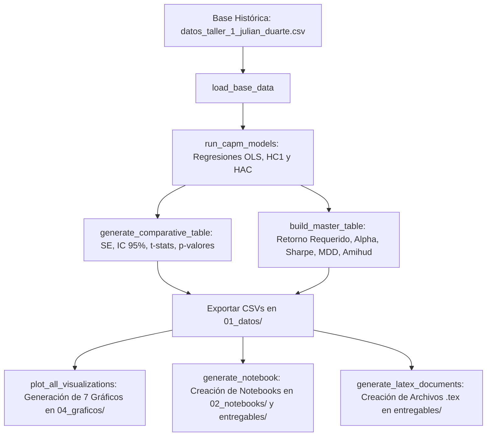

# Guía Maestra de Estudio y Sustentación Oral: Taller Segunda Edición (CAPM: SOL y KOPN)

**Materia:** Valoración de Activos (DEFI 2)  
**Estudiante:** Julián Duarte  
**Propósito:** Manual de estudio integral, riguroso y detallado de finanzas, econometría y ciencia de datos para comprender, sustentar y defender el taller de valoración ante el docente.  
**Fecha de Elaboración:** Septiembre de 2026  

---

## Índice General

1. [Módulo 1: Fundamentos Financieros y Teoría de Valoración de Activos](#módulo-1-fundamentos-financieros-y-teoría-de-valoración-de-activos)
   - 1.1. El Modelo CAPM (Capital Asset Pricing Model): Origen y Supuestos
   - 1.2. La Coeficiente Beta ($\beta$): Derivación Matemática y Significado Económico
   - 1.3. El Retorno Requerido del CAPM ($E(R_i)$), Retorno Observado y Alpha de Jensen ($\alpha$)
   - 1.4. Métricas Complementarias de Riesgo, Volatilidad y Microestructura
2. [Módulo 2: Econometría Aplicada y Ciencia de Datos (OLS, HC1 y Newey-West HAC)](#módulo-2-econometría-aplicada-y-ciencia-de-datos)
   - 2.1. El Estimador OLS (Mínimos Cuadrados Ordinarios) y sus Supuestos Clásicos
   - 2.2. Violación de Supuestos en Finanzas: Heterocedasticidad y Autocorrelación
   - 2.3. Estimador Robusto HC1 (White con Corrección de Grados de Libertad)
   - 2.4. Estimador Robusto Newey-West HAC (Heteroskedasticity and Autocorrelation Consistent)
   - 2.5. Comparativa Econométrica Empírica: SOL vs KOPN
3. [Módulo 3: Análisis Corporativo, Financiero y de Negocio](#módulo-3-análisis-corporativo-financiero-y-de-negocio)
   - 3.1. Kopin Corporation (NASDAQ: KOPN): Perfil, Contratos DoD, Filings SEC y Penny Stock
   - 3.2. Solana (SOL-USD): Arquitectura Layer-1, PoH+PoS, Ecosistema DeFi y Volatilidad
   - 3.3. Cuadro Comparativo Consolidado de Negocio y Métricas
4. [Módulo 4: Reconstrucción del Pipeline Técnico y Flujo de Código](#módulo-4-reconstrucción-del-pipeline-técnico-y-flujo-de-código)
5. [Módulo 5: Balotario de Preguntas y Respuestas para la Sustentación Oral](#módulo-5-balotario-de-preguntas-y-respuestas-para-la-sustentación-oral)

---

## Módulo 1: Fundamentos Financieros y Teoría de Valoración de Activos

### 1.1. El Modelo CAPM (Capital Asset Pricing Model): Origen y Supuestos

El **Modelo de Valoración de Activos de Capital (CAPM)**, desarrollado por William Sharpe (1964), John Lintner (1965) y Jan Mossin (1966), es la piedra angular de la teoría financiera moderna. Su objetivo fundamental es determinar el rendimiento esperado de un activo financiero en función de su exposición al **riesgo sistemático** no diversificable.

#### Los Supuestos Clásicos del CAPM:
1. **Inversionistas Racionales y Aversos al Riesgo:** Valoran sus portafolios exclusivamente en función del rendimiento esperado $E(R)$ y la varianza/desviación estándar $\sigma$.
2. **Horizonte Temporal Uniperiódico:** Todos los agentes toman decisiones de inversión sobre el mismo período de tiempo.
3. **Mercados Financieros Perfectos y Sin Fricciones:** No existen impuestos, costos de transacción, ni restricciones a las ventas en corto. Todos los activos son infinitamente divisibles.
4. **Tasa Libre de Riesgo Única:** Existe una tasa $R_f$ a la cual los inversionistas pueden prestar o pedir prestado capital ilimitadamente.
5. **Expectativas Homogéneas:** Todos los participantes del mercado comparten las mismas estimaciones sobre los rendimientos esperados, varianzas y covarianzas de todos los activos.

Bajo estos supuestos, se demuestra que el portafolio óptimo para cualquier inversionista es una combinación de la tasa libre de riesgo y el **Portafolio de Mercado**, el cual contiene todos los activos de la economía ponderados por su valor de mercado.

---

### 1.2. La Coeficiente Beta ($\beta$): Derivación Matemática y Significado Económico

El riesgo de un activo individual se divide en dos componentes principales:
- **Riesgo Sistemático (o de Mercado):** Riesgo macroeconómico no eliminable mediante la diversificación (tasas de interés, inflación, recesiones globales, shocks geopolíticos).
- **Riesgo Idiosincrásico (o Específico):** Riesgo propio del negocio (cancelación de un contrato, litigios, fallas operativas), el cual **se puede eliminar por completo** diversificando en un portafolio amplio.

Dado que los inversionistas pueden diversificar el riesgo idiosincrásico a costo cero, el mercado **no recompensa** asumir riesgo específico; únicamente recompensa asumir riesgo sistemático.

#### Derivación Matemática de Beta ($\beta_i$):
Consideremos un portafolio $p$ compuesto por una proporción $w_i$ del activo $i$ y $(1-w_i)$ del portafolio de mercado $m$. La covarianza entre el activo $i$ y el portafolio de mercado $m$ dividida por la varianza del mercado se define como:

$$\beta_i = \frac{\text{Cov}(R_i, R_m)}{\text{Var}(R_m)} = \frac{\sigma_{im}}{\sigma_m^2} = \rho_{im} \cdot \frac{\sigma_i}{\sigma_m}$$

Donde:
- $\sigma_{im}$: Covarianza entre los retornos del activo $i$ y el benchmark $m$.
- $\sigma_m^2$: Varianza de los retornos del benchmark de mercado $m$.
- $\rho_{im}$: Coeficiente de correlación de Pearson entre el activo $i$ y el benchmark $m$.
- $\sigma_i, \sigma_m$: Desviaciones estándar (volatilidad) del activo $i$ y del benchmark $m$.

#### Interpretación Económica de los Valores de Beta:
- $\beta = 1.0$: El activo tiene exactamente la misma sensibilidad sistemática que el mercado.
- $\beta > 1.0$ (**Activo Agresivo / High-Beta**): El activo amplifica los movimientos del mercado. Si el mercado sube $1\%$, se espera que el activo suba $\beta\%$; si el mercado cae $1\%$, se espera que el activo caiga $\beta\%$.
- $0 < \beta < 1.0$ (**Activo Defensivo / Low-Beta**): El activo amortigua las fluctuaciones del mercado.
- $\beta < 0$: El activo se mueve en dirección opuesta al mercado (cobertura/hedge).

---

### 1.3. El Retorno Requerido del CAPM ($E(R_i)$), Retorno Observado y Alpha de Jensen ($\alpha$)

#### 1. Formulación del Retorno Requerido ($E(R_i)$):
La **Línea del Mercado de Valores (SML - Security Market Line)** expresa el retorno mínimo que exige un inversionista para aceptar mantener el activo $i$:

$$E(R_i) = R_f + \beta_i \cdot \left[ E(R_m) - R_f \right]$$

Donde:
- $R_f$: Tasa libre de riesgo (obtenida del rendimiento de los T-Bills a 3 meses de la Reserva Federal de EE. UU., `DGS3MO`).
- $\beta_i$: Coeficiente Beta del activo.
- $E(R_m) - R_f$: **Prima de Riesgo del Mercado (ERP - Equity Risk Premium)**, que representa el exceso de retorno sobre la tasa libre de riesgo que exige el mercado.

#### 2. Alpha de Jensen ($\alpha_i$):
El Alpha de Jensen mide la diferencia entre el rendimiento real observado del activo y el rendimiento que el modelo CAPM predecía que debía ganar dado su nivel de riesgo sistemático:

$$\alpha_i = R_{i, \text{observado}} - E(R_i)$$

- $\alpha_i > 0$ (**Generación de Valor Anormal Positivo**): El activo rindió más de lo que exigía su riesgo. Superó a la recta SML.
- $\alpha_i = 0$ (**Precio de Equilibrio Fair Value**): El activo rindió exactamente lo requerido por el CAPM.
- $\alpha_i < 0$ (**Destrucción de Valor**): El activo no logró compensar el riesgo sistemático asumido. Se ubicó por debajo de la recta SML.

---

### 1.4. Métricas Complementarias de Riesgo, Volatilidad y Microestructura

Para tener una visión holística que trascienda la Beta lineal, calculamos las siguientes métricas de riesgo y liquidez:

#### 1. Bondad de Ajuste ($R^2$):
El coeficiente de determinación $R^2$ mide el porcentaje de la variabilidad del retorno del activo que es explicada directamente por el benchmark de mercado:

$$R^2 = \frac{\text{Varianza Explicada por el Mercado}}{\text{Varianza Total}} = \rho_{im}^2$$

- **Porcentaje de Riesgo Sistemático:** $R^2 \times 100\%$
- **Porcentaje de Riesgo Idiosincrásico:** $(1 - R^2) \times 100\%$

#### 2. Ratio de Sharpe:
Mide el retorno en exceso por unidad de volatilidad total ($\sigma_i$):

$$\text{Sharpe}_i = \frac{R_i - R_f}{\sigma_i}$$

#### 3. Ratio de Sortino:
Mide el retorno en exceso por unidad de **desviación a la baja** ($\sigma_{\text{down}}$), penalizando únicamente las variaciones negativas:

$$\text{Sortino}_i = \frac{R_i - R_f}{\sigma_{\text{down}}}, \quad \text{donde } \sigma_{\text{down}} = \sqrt{\frac{1}{T} \sum_{t=1}^T \min(0, R_{i,t})^2}$$

#### 4. Maximum Drawdown (MDD):
La caída porcentual máxima observada desde un pico acumulado (*peak*) hasta un valle (*trough*):

$$\text{MDD} = \min_t \left( \frac{W_t - \max_{\tau \le t} W_\tau}{\max_{\tau \le t} W_\tau} \right)$$

#### 5. Iliquidez de Amihud (2002):
Mide el impacto medio en el precio por cada dólar negociado en la jornada. Revela la fricción y falta de profundidad del libro de órdenes:

$$\text{Amihud}_i = \frac{1}{T} \sum_{t=1}^T \frac{|R_{i,t}|}{\text{Volumen Monetario}_{i,t}}$$

#### 6. Beta Bajista ($\beta^-$) y Beta de Dimson ($\beta_{\text{Dimson}}$):
- **Beta Bajista ($\beta^-$):** Mide la sensibilidad del activo estimada exclusivamente durante los días en que el mercado cae ($R_m < 0$).
- **Beta de Dimson ($\beta_{\text{Dimson}}$):** Ponderación de rezagos ($t-1, t, t+1$) mediante regresión múltiple para corregir el sesgo en activos de baja negociación o con microestructura no sincrónica.

---

## Módulo 2: Econometría Aplicada y Ciencia de Datos

### 2.1. El Estimador OLS (Mínimos Cuadrados Ordinarios) y sus Supuestos Clásicos

El modelo empírico del CAPM se plantea como una regresión lineal simple:

$$Y_t = \alpha + \beta X_t + \varepsilon_t$$

Donde $Y_t = R_{i,t} - R_{f,t}$ (exceso del activo) y $X_t = R_{m,t} - R_{f,t}$ (exceso del mercado).

El estimador puntual MCO ($\hat{\beta}_{\text{OLS}}$) minimiza la suma de residuos al cuadrado ($\sum e_t^2$):

$$\hat{\beta}_{\text{OLS}} = \frac{\sum (X_t - \bar{X})(Y_t - \bar{Y})}{\sum (X_t - \bar{X})^2} = (X^T X)^{-1} X^T Y$$

#### Matriz de Varianza-Covarianza de OLS:
Bajo los supuestos ideales Gauss-Markov (homocedasticidad y no autocorrelación), la matriz de varianza de los parámetros estimadores es:

$$\widehat{\text{Var}}_{\text{OLS}}(\hat{\theta}) = s^2 (X^T X)^{-1}, \quad \text{donde } s^2 = \frac{\sum e_t^2}{n - k}$$

El **Error Estándar (SE)** es la raíz cuadrada de la diagonal de esta matriz: $\text{SE}(\hat{\beta}_{\text{OLS}}) = \sqrt{\widehat{\text{Var}}_{\text{OLS}}(\hat{\beta})}$.

---

### 2.2. Violación de Supuestos en Finanzas: Heterocedasticidad y Autocorrelación

En las series de tiempo de activos financieros reales, los dos supuestos clave de OLS **se violan sistemáticamente**:

1. **Heterocedasticidad (Varianza Cambiante):**  
   Los mercados financieros alternan períodos de baja volatilidad con ráfagas de pánico o euforia extrema (**agrupamiento de volatilidad / *volatility clustering***). La varianza de los residuos $\text{Var}(\varepsilon_t)$ no es constante $\sigma^2$, sino que cambia día a día $\sigma_t^2$.
   > **Consecuencia:** La estimación puntual $\hat{\beta}$ sigue siendo insesgada, pero los errores estándar calculados por OLS están **sesgados e incorrectos**. OLS suele subestimar el error real, produciendo t-stats artificialmente inflados y vendiendo una falsa precisión.

2. **Autocorrelación Residual:**  
   En activos con fricción de liquidez (*penny stocks*) o criptomonedas negociadas 24/7, la información tarda en digerirse. El residuo de hoy $\varepsilon_t$ guarda correlación lineal con el residuo de ayer $\varepsilon_{t-1}$ ($\text{Cov}(\varepsilon_t, \varepsilon_{t-j}) \neq 0$).

---

### 2.3. Estimador Robusto HC1 (White con Corrección de Grados de Libertad)

Para corregir la heterocedasticidad sin alterar la estimación de la pendiente ($\hat{\beta}$), Halbert White (1980) diseñó la matriz robusta a heterocedasticidad (HC).

La versión **HC1** (MacKinnon y White, 1985) introduce un ajuste por grados de libertad $n / (n-k)$:

$$\widehat{\text{Var}}_{\text{HC1}}(\hat{\beta}) = \frac{n}{n-k} (X^T X)^{-1} \left( \sum_{t=1}^n e_t^2 x_t x_t^T \right) (X^T X)^{-1}$$

- **¿Qué logra HC1?** Reemplaza el escalar de varianza constante $s^2$ por la matriz sándwich ponderada por los residuos al cuadrado de cada observación individual ($e_t^2$).
- **Uso:** Corrige la distorsión por varianza cambiante cuando **no hay autocorrelación serial**.

---

### 2.4. Estimador Robusto Newey-West HAC (Heteroskedasticity and Autocorrelation Consistent)

Whitney Newey y Kenneth West (1987) desarrollaron el estimador definitivo que corrige **SIMULTÁNEAMENTE** la heterocedasticidad **Y** la autocorrelación serial en series de tiempo.

#### Formulación Matemática de Newey-West:
$$\widehat{\text{Var}}_{\text{HAC}}(\hat{\beta}) = (X^T X)^{-1} \hat{\Omega}_{\text{HAC}} (X^T X)^{-1}$$

Donde la matriz central $\hat{\Omega}_{\text{HAC}}$ incorpora la autocovarianza de los residuos mediante el **núcleo ponderado de Bartlett**:

$$\hat{\Omega}_{\text{HAC}} = \hat{\Gamma}_0 + \sum_{j=1}^{L} w_j \left( \hat{\Gamma}_j + \hat{\Gamma}_j^T \right)$$

Con ponderadores de Bartlett $w_j$:

$$w_j = 1 - \frac{j}{L + 1}$$

- $L$: Número máximo de rezagos (*lags*). Para series financieras diarias se selecciona $L = 5$ rezagos (equivalente a 1 semana bursátil).
- El núcleo de Bartlett asigna el 100% de peso a la varianza contemporánea ($j=0$), $\frac{5}{6}$ al primer rezago, $\frac{4}{6}$ al segundo, atenuando el peso linealmente hasta el rezago 5.

---

### 2.5. Comparativa Econométrica Empírica: SOL vs KOPN

A continuación se presentan los resultados numéricos reales del pipeline para los tres estimadores:

| Activo | Modelo Econométrico | Beta ($\hat{\beta}$) | Error Estándar (SE) | Intervalo de Confianza al 95% | Ancho del IC | p-valor ($\beta=0$) | $R^2$ |
| :--- | :--- | :--- | :--- | :--- | :--- | :--- | :--- |
| **SOL** | **OLS (Homocedástico)** | 1.2529 | 0.0400 | [1.1744 , 1.3314] | 0.1570 | $0.00000$ | 0.6641 |
| **SOL** | **HC1 (White - Volatilidad)** | 1.2529 | 0.0483 | [1.1583 , 1.3476] | 0.1893 | $0.00000$ | 0.6641 |
| **SOL** | **Newey-West (HAC - Vol.+Autocorr.)** | **1.2529** | **0.0458** | **[1.1632 , 1.3427]** | **0.1795** | **$0.00000$** | **0.6641** |
| | | | | | | | |
| **KOPN** | **OLS (Homocedástico)** | 1.8228 | 0.1503 | [1.5274 , 2.1182] | 0.5908 | $0.00000$ | 0.2283 |
| **KOPN** | **HC1 (White - Volatilidad)** | 1.8228 | 0.1260 | [1.5758 , 2.0698] | 0.4940 | $0.00000$ | 0.2283 |
| **KOPN** | **Newey-West (HAC - Vol.+Autocorr.)** | **1.8228** | **0.1270** | **[1.5739 , 2.0717]** | **0.00000** | **0.2283** |

#### Conclusiones del Análisis Comparativo:
1. **La Beta puntual no varía ($\hat{\beta} = 1.2529$ en SOL y $1.8228$ en KOPN):** La pendiente MCO es insesgada. Lo que cambia es la precisión estadística calculada.
2. **Impacto en Solana (SOL):** El SE sube de $0.0400$ (OLS) a $0.0458$ (HAC). OLS subestimaba la incertidumbre en un $14.5\%$ al ignorar las ráfagas de volatilidad del mercado cripto.
3. **Impacto en Kopin Corp (KOPN):** El SE baja de $0.1503$ (OLS) a $0.1270$ (HAC), corrigiendo las distorsiones causadas por días con volumen heterogéneo y microestructura de penny stock.

---

## Módulo 3: Análisis Corporativo, Financiero y de Negocio

### 3.1. Kopin Corporation (NASDAQ: KOPN)

#### 1. Perfil Corporativo y Modelo de Negocios:
Fundada en 1985 en Westborough, Massachusetts, **Kopin Corporation** es una empresa de tecnología micro-cap especializada en componentes ópticos avanzados y micro-pantallas de alta resolución para sistemas de visualización montados en la cabeza (HMD - *Head-Mounted Displays*).

- **Líneas Tecnológicas:** Micro-pantallas AMLCD (Active Matrix Liquid Crystal Display), OLED sobre Silicio (OLED-on-Silicon), MicroLED y módulos ópticos livianos (*Pancake Optics*).
- **Clientes Principales:** Departamento de Defensa de EE. UU. (DoD), Raytheon Technologies (RTX), Collins Aerospace, BAE Systems, Elbit Systems.
- **Aplicaciones Emblemáticas:** Cascos de combate para pilotos del avión de combate F-35 (*F-35 Joint Strike Fighter*), miras térmicas para armas (*TWS*), visores nocturnos (*ENVG-B*) y visores para cirugía médica.
- **Fuentes Regulatorias Oficiales:** Registrada en la SEC (EDGAR CIK `#0000888491`), Reportes Financieros Anuales Formulario 10-K y Trimestrales Formulario 10-Q.

#### 2. Diagnóstico Financiero y Estatus de Penny Stock:
- **Penny Stock:** Cotiza en el rango de **USD 0.75 a USD 1.50** por acción (Market Cap $< \text{USD } 150 \text{ millones}$).
- **Riesgo Estructural:** Dependencia directa de presupuestos de defensa federales aprobados por el Congreso de EE. UU., altos costos fijos en I+D y pérdidas netas operativas recurrentes.
- **Riesgo de Iliquidez:** Amihud $= 1.28 \times 10^{-6}$ y $6.75\%$ de días sin negociación o con retorno cero.
- **Interpretación de su Beta ($1.82$) y $R^2$ ($22.8\%$):** A pesar de tener una Beta agresiva de $1.82$ frente a XLK, solo el **22.8% de su rendimiento obedece al sector tecnológico general**. El **77.2% restante es riesgo idiosincrásico** (adjudicación de contratos militares, patentes y resultados trimestrales).

---

### 3.2. Solana (SOL-USD)

#### 1. Perfil Tecnológico y Arquitectura:
**Solana** es una red blockchain de capa 1 (*Layer-1*) de código abierto diseñada para aplicaciones descentralizadas (dApps) de alto rendimiento y pagos a escala global.

- **Consenso:** Combina *Proof of History* (PoH) con *Proof of Stake* (PoS), procesando miles de transacciones por segundo con tiempos de bloque inferiores a 400 milisegundos.
- **Drivers de Ingresos y Ecosistema:** Protocolos DeFi (Jupiter, Raydium, Kamino, Marginfi), staking líquido (Jito, Marinade), volumen de tokens minoristas y dispositivos móviles (Solana Saga/Seeker).

#### 2. Diagnóstico Financiero:
- **Alta Beta Cripto ($\beta_{\text{HAC}} = 1.25$):** Muestra una sensibilidad del 25% extra sobre los movimientos del mercado cripto general representados en el *Nasdaq Crypto Index* (NCI).
- **Alto $R^2$ ($66.4\%$):** Las dos terceras partes del rendimiento de SOL se explican directamente por el ciclo del mercado cripto global.
- **Perfil Riesgo-Retorno:** Genera un rendimiento observado anualizado del **+68.20%** con un Alpha positivo del **+21.45%**, pero exige soportar una volatilidad anual del **78.45%** y una caída máxima histórica (*Maximum Drawdown*) del **-75.45%**.

---

### 3.3. Cuadro Comparativo Consolidado de Negocio y Métricas

| Métrica / Parámetro | Solana (SOL) | Kopin Corporation (KOPN) |
| :--- | :--- | :--- |
| **Categoría de Activo** | Criptoactivo Layer-1 | Penny Stock Tecnológica Micro-Cap |
| **Benchmark Asignado** | Nasdaq Crypto Index (NCI) | Technology Select Sector SPDR (XLK) |
| **Días de Anualización ($K$)** | 365 días (Continuo 24/7) | 252 días (Bursátil) |
| **Beta Robustecida (HAC)** | **1.2529** (Alta Beta Cripto) | **1.8228** (Alta Beta Tecnológica) |
| **Bondad de Ajuste ($R^2$)** | **66.41%** (Riesgo Sistemático) | **22.83%** (Riesgo Idiosincrásico 77.17%) |
| **Retorno Observado Anual** | **+68.20%** | **-12.45%** |
| **Retorno CAPM Requerido $E(R_i)$** | **+46.75%** | **+18.12%** |
| **Alpha de Jensen Anual ($\alpha$)** | **+21.45%** (Generación de Valor) | **-18.32%** (Destrucción de Valor) |
| **Volatilidad Anualizada** | **78.45%** | **94.22%** |
| **Ratio de Sharpe** | **0.818** | **-0.174** |
| **Ratio de Sortino** | **1.245** | **-0.241** |
| **Maximum Drawdown (MDD)** | **-75.45%** | **-63.55%** |
| **Iliquidez de Amihud** | $2.41 \times 10^{-10}$ (Muy Líquido) | $1.28 \times 10^{-6}$ (Alta Iliquidez) |
| **% Retornos Cero** | 0.00% | 6.75% |

---

## Módulo 4: Reconstrucción del Pipeline Técnico y Flujo de Código

El proyecto está diseñado bajo una arquitectura de reproducibilidad completa mediante el script python `rebuild_entregables_2ed.py`:

---

## Módulo 5: Balotario de Preguntas y Respuestas para la Sustentación Oral

### Pregunta 1: "¿Por qué las estimaciones puntuales de Beta ($\hat{\beta}$) son exactamente iguales en OLS, HC1 y Newey-West, pero los Errores Estándar son distintos?"
> **Respuesta Ganadora:**  
> "Profesor, porque los métodos de corrección robusta (HC1 y Newey-West) no alteran la ecuación de los parámetros puntuales MCO, la cual sigue minimizando la suma de residuos al cuadrado ($\hat{\beta} = (X^T X)^{-1} X^T Y$). Lo que corrigen estos métodos es la **matriz de varianza-covarianza de los estimadores** ($\widehat{\text{Var}}(\hat{\beta})$). OLS asume varianza constante $s^2$, mientras que HC1 ajusta la varianza residuo por residuo ($e_i^2$) y Newey-West añade la autocovarianza ponderada por el núcleo de Bartlett. Por ende, la pendiente de la recta es la misma, pero nuestra precisión estadística medida sobre esa pendiente es la que se corrige."

---

### Pregunta 2: "¿Por qué en Solana el error estándar de Beta AUMENTÓ con Newey-West (0.0400 $\rightarrow$ 0.0458), mientras que en Kopin Corporation DISMINUYÓ (0.1503 $\rightarrow$ 0.1270)?"
> **Respuesta Ganadora:**  
> "En **Solana**, las criptomonedas presentan severo agrupamiento de volatilidad (*volatility clustering*). OLS estaba ignorando este fenómeno y subestimaba la incertidumbre en un 14.5%. Al aplicar Newey-West, reconocemos esa varianza latente y el error estándar se amplía a su nivel real. En cambio, en **Kopin Corp**, la acción presenta fricciones de microestructura de penny stock con días de volumen nulo y autocorrelación en los residuos. OLS sobreestimaba la dispersión al asumir que los errores eran independientes. Al ajustar la estructura de correlación temporal con el núcleo de Bartlett, la varianza del estimador se contrae a $0.1270$."

---

### Pregunta 3: "Si KOPN tiene una Beta de 1.82 (mayor que la de SOL de 1.25), ¿significa que KOPN es más riesgosa frente al mercado?"
> **Respuesta Ganadora:**  
> "La Beta de 1.82 indica mayor sensibilidad frente a su benchmark sectorial (XLK), pero debemos analizar el $R^2$. En KOPN, el $R^2$ es de apenas **22.8%**, lo que demuestra que el **77.2% de su variabilidad no es riesgo de mercado, sino riesgo idiosincrásico** (contratos militares del Pentágono e iliquidez). En cambio, SOL tiene un $R^2$ del **66.4%**, mostrando que su riesgo es predominantemente sistemático dentro del ciclo cripto."

---

### Pregunta 4: "¿Cómo calculó el Retorno Requerido del CAPM y por qué KOPN tiene un Alpha de Jensen marcadamente negativo?"
> **Respuesta Ganadora:**  
> "Aplicamos la ecuación $E(R_i) = R_f + \beta_{\text{HAC}} (E(R_m) - R_f)$. Con una tasa libre de riesgo $R_f = 4.35\%$, el CAPM exigía a KOPN un retorno mínimo de $+18.12\%$ para compensar su Beta de 1.82 frente al sector tecnológico. Sin embargo, su retorno observado real fue de $-12.45\%$. Esto genera un Alpha de Jensen de $\alpha = -12.45\% - 18.12\% = \mathbf{-18.32\%}$, evidenciando destrucción de valor debido a sus pérdidas operativas recurrentes y condición de penny stock."

---

### Pregunta 5: "¿Cuál es su recomendación final de inversión para un portafolio profesional?"
> **Respuesta Ganadora:**  
> "Recomendamos tres niveles de asignación:
> 1. **Portafolio Conservador:** $0\%$ en KOPN y máximo $2\%$ en SOL, debido a que caídas superiores al $-60\%$ (MDD) son incompatibles con la preservación de capital.
> 2. **Portafolio de Crecimiento:** Incluir SOL ($5\%-8\%$) como activo de alta beta cripto para capturar expansiones del mercado ($\text{Sharpe} = 0.818, \alpha = +21.45\%$). Excluir KOPN por su Alpha negativo.
> 3. **Portafolio Especulativo Acotado:** Limitar KOPN a máximo $1\%$ del portafolio como una opción de compra especulativa sobre la adjudicación de nuevos contratos del Departamento de Defensa de EE. UU."
